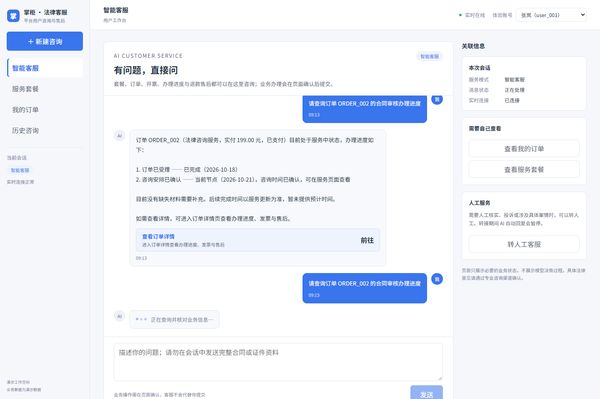
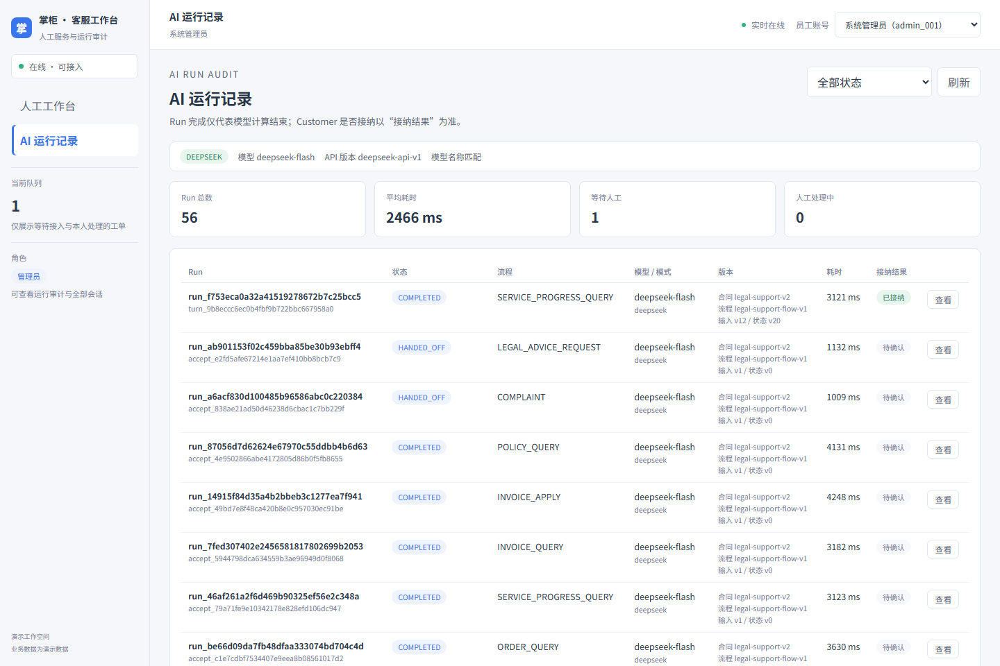

# 法律咨询平台智能客服 · DeepSeek 交付版

原有会话服务、业务工具、多轮 FlowState、人工接管、前端和运行审计继续复用。模型改为官方 DeepSeek API，默认 `deepseek-flash`，关闭思考模式，使用原生工具调用与结构化输出。训练、LoRA、权重和自部署管线已移出当前代码，无需 GPU。离线 fixture 仅用于回归测试。

## 目录

`ai-service`：模型与受控工具；`customer-service`：会话、Worker、人工工单；`legal-business-service`：演示业务事实；`user-frontend` / `admin-frontend`：用户与后台页面；`deploy`：PG / Redis；`scripts` / `tests` / `reports`：验证代码与报告。交付根目录 `测试截图` 保存实际运行截图。

不包含 `.venv`、`node_modules`、权重、真实 `.env`、数据库、运行日志或 Git 历史。保留 requirements、pyproject、package-lock 作为安装清单。

## 启动（Windows PowerShell）

准备 Python 3.13、Node.js 22.12+、Docker Desktop。以下命令从交付根目录执行；两个服务同名 `atguigu` 包，必须在各自目录启动。

```powershell
python -m venv .venv
& ./.venv/Scripts/python.exe -m pip install -r ./代码/requirements.txt
foreach ($service in 'ai-service','customer-service','legal-business-service','user-frontend','admin-frontend') {
    $target = "./代码/$service/.env"
    if (!(Test-Path $target)) { Copy-Item "./代码/$service/.env.example" $target }
}
docker compose -f ./代码/deploy/docker-compose.yml up -d
docker compose -f ./代码/deploy/docker-compose.yml ps
```

等待 PG / Redis 均为 healthy。首次初始化：

```powershell
Push-Location ./代码/ai-service
& ../../.venv/Scripts/python.exe -m atguigu.infrastructure.init_db
Pop-Location
Push-Location ./代码/customer-service
& ../../.venv/Scripts/python.exe -m atguigu.infrastucture.init_db
Pop-Location
```

真实密钥填写 `代码/ai-service/.env` 的 `DEEPSEEK_API_KEY`，或设置 AI 进程同名环境变量。不要提交密钥。地址默认 `https://api.deepseek.com`。先启动业务服务，再启动 AI。模型不可用会明确降级，不回退到 fixture。

下面每行从交付根目录在独立终端运行：

```powershell
cd 代码/legal-business-service; ../../.venv/Scripts/python.exe -m atguigu_legal.main
cd 代码/ai-service; ../../.venv/Scripts/python.exe -m atguigu.main
cd 代码/customer-service; ../../.venv/Scripts/python.exe -m atguigu.main
cd 代码/customer-service; ../../.venv/Scripts/python.exe -m atguigu.worker.ai.worker
cd 代码/customer-service; ../../.venv/Scripts/python.exe -m atguigu.worker.realtime
```

用户端：

```powershell
cd 代码/user-frontend
npm ci
npm run build
npm run preview -- --host 127.0.0.1 --port 4173
```

管理端在独立终端对 `代码/admin-frontend` 执行相同命令，端口改为 `4174`。

用户端 http://127.0.0.1:4173；后台 http://127.0.0.1:4174；Customer API 8010；业务 8001；AI 8002。
用户端默认 user_001，后台切换 admin_001 可查看模型、工具链、token、耗时与接纳结果。

## 验证

2026-10-24 本机实际验证：AI 36 项、Customer 19 项、契约 7 项，共 62 项通过；两个前端构建通过。真实 DeepSeek 9 项、只读集成 12 项通过；浏览器验证发送 → Worker → 模型 → 工具 → 结算 → Outbox → WebSocket → DOM，并保存 8 张截图。人工接管验证抢单冲突、暂停 AI、FlowState 递增与结单后业务查询恢复。证据在 reports。

```powershell
# 分别在 ai-service、customer-service 目录执行；Customer 使用独立测试库
../../.venv/Scripts/python.exe -m pytest tests -q
# 以下从 代码 目录执行；集成验证需服务全部启动，真实模型调用消耗 API 配额
../.venv/Scripts/python.exe -m pytest tests/contract -q
../.venv/Scripts/python.exe scripts/verify_project.py
../.venv/Scripts/python.exe scripts/verify_deepseek.py
../.venv/Scripts/python.exe scripts/browser_acceptance.py
# 从 customer-service 目录执行，会修改演示工单与会话
../../.venv/Scripts/python.exe tests/e2e_human_handoff.py
```

浏览器脚本需 Chrome，可通过 CHROME_PATH 指定路径；使用独立临时配置，截图未经修改。

## 接入与边界

配置 → ChatDeepSeek → policy 识别意图/槽位 → 代码计算执行计划 → execution 调只读工具 → 服务端校验事实/归属/页面动作 → FlowState 原子结算。退款、开票申请仍由用户在业务页面确认。

数据库保留 model_artifact_version / adapter_version 列以兼容现有表；记录 API 集成版本与 not-applicable，不再表示训练产物。

这是**真实 DeepSeek + 演示业务服务**的本机交付版，不连接真实支付、不执行真实资金退款、不提供个案法律意见。演示账号签发、默认数据库密码与 JWT 示例值仅适合本机。生产需替换身份和密钥、对接真实业务与专业人工，并完成负载、恢复和依赖审计；npm 安装审计存在高危依赖告警，本次未扩大范围升级依赖。

参数依据：[DeepSeek 官方 API 文档](https://api-docs.deepseek.com/api/create-chat-completion)。模型以真实对话与工具审计验收，不仅依赖健康检查。

## 运行截图




